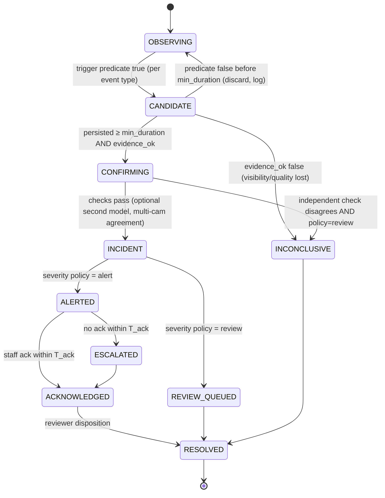

# AI Model Strategy

**Date:** 2026-10-27 · **Status:** Design. No model has been trained or validated yet.
Related: [RESEARCH_REPORT](RESEARCH_REPORT.md) · [SAFETY_VALIDATION](SAFETY_VALIDATION.md)

---

## 1. Principles

1. **Smallest model set that produces a measurable safety-review benefit.** Start with deterministic rules over detection, tracking, pose and zones. Add learned classifiers only when an experiment shows they reduce misses or false alerts.
2. **Detectors observe, the event engine decides** (ADR-002). No safety logic hides in a model or prompt.
3. **Every observation carries quality.** Low quality yields *inconclusive*, never "safe".
4. **Per-event thresholds,** with no single "risk score". Scores are not calibrated probabilities of harm unless calibrated on in-domain labelled incidents.
5. **Licensing-safe stack only in product** (ADR-004).

---

## 2. Event taxonomy and feasibility

Feasibility combines technical observability on ordinary CCTV, data availability and validation difficulty [E].

| ID | Event | Family | Observable on CCTV? | Data obtainable ethically? | Feasibility | Initial product mode |
|---|---|---|---|---|---|---|
| D1 | Camera offline / frozen / black | D | ✅ Deterministic | ✅ Synthetic faults | **High** | **Alert (ops)** — MVP |
| D2 | Camera obstructed / view changed | D | ✅ | ✅ Staged | **High** | **Alert (ops)** — MVP |
| D3 | Person in restricted zone (e.g. kitchen door, exit) | D | ✅ Adult detection is mature | ✅ Staged adults | **High** | Alert after shadow validation |
| D4 | Infant in restricted/floor-hazard zone | D | ⚠️ Infant detection must be fine-tuned | ✅ Manikin + consented | **Medium** | Review → alert after validation |
| D5 | No adult present in room with infant(s) for > T | D | ⚠️ Requires full room coverage. Blind spots break it | ✅ Staged | **Medium** (coverage-dependent) | Review signal. Never presented as a staffing-compliance tool |
| D6 | Crowding near crib (> N adults within zone) | D | ✅ | ✅ | Medium | Review |
| A1 | **Infant left raised surface unexpectedly** (crib/changing table → floor) | A | ⚠️ Depends on camera angle showing surface and floor | ✅ Manikin drops (no real infants) | **Medium** | Shadow → alert if validated |
| A2 | Abrupt downward movement of an infant | A | ⚠️ Fall ≈0.35–0.45 s; needs ≥15 fps | ✅ Manikin | Medium–Low | Review |
| A3 | Unusual posture transition (e.g. sudden prone after standing) | A | ⚠️ Pose quality limited | ⚠️ | Low–Medium | Research |
| B1 | Abrupt/forceful handling of an infant by an adult | B | ❌/⚠️ Very hard to separate from rocking, bouncing, swift lifts. Small pixel size | ⚠️ Only manikin/staged proxies. Real positives are rare and ethically sensitive | **Low** | **Review-only research signal. Never an accusation** |
| B2 | Repetitive shaking-like motion | B | ❌/⚠️ Needs high fps + resolution. Indistinguishable from soothing bounce without context | ⚠️ Manikin only | **Low** | Research only |
| B3 | Throwing/dragging-like motion | B | ⚠️ | ⚠️ Manikin | Low | Research only |
| C1 | No visible movement of an infant for > T while *not* in a sleep zone/period | C | ⚠️ Blankets, occlusion | ✅ | Low–Medium | Low-priority review. **Not a medical alarm** |
| C2 | Infant body visibility lost (covered/obstructed) for > T in crib | C | ⚠️ Can't tell a blanket over the face from a blanket over the legs reliably | ✅ Manikin + blankets | Low–Medium | Review |
| C3 | Sudden change in movement pattern vs. baseline | C | ⚠️ | ⚠️ | Low | Research |
| E1 | Visual respiration estimate | E | ❌ for wide-angle daycare CCTV (no evidence). Research on close-up baby monitors only | ❌ Research-only data (AIR-400 NC) | **Research only** | **Not a product feature.** Regulatory review required |

**Things ordinary CCTV cannot tell you [E]:** intent, force magnitude, injury, pain, breathing adequacy, whether a child is asleep or unwell, or who a person is (without biometrics, which we exclude). The product must say so in the UI and documentation.

---

## 3. Pipeline (per camera)

```
frame (5 fps base, ≥15 fps on raised-surface cameras)
  → quality module (black/frozen/blur/IR/obstruction)            [classical CV]
  → detector: {adult, infant, crib, changing_table, ...}         [YOLOX/RT-DETR, fine-tuned]
  → ByteTrack (per camera)                                        [MIT]
  → pose on infant & adult crops (RTMPose-s/m) + pose_quality     [Apache-2.0, fine-tuned]
  → features: zone membership, bbox bottom vs surface polygon, vertical velocity,
              posture state {lying, sitting, standing, held, unknown}
  → Observation → core event engine (rules per event type)
  → [P1] PoseC3D skeleton classifier on candidate windows (2–4 s)
  → [P2] X3D RGB verifier on candidate windows
  → [P2] VLM summary of evidence clip (advisory, post-incident)
```

### 3.1 Why "held" matters
Many false alerts come from caregivers carrying infants. The detector + tracker must output an **infant-held** state (infant bbox overlapping an adult bbox with an elevated centroid). Zone rules (A1, D4) are suppressed while the infant is held, and handling rules (B1) apply only while held. This one state removes whole classes of confusions [H, test in Phase 2].

---

## 4. Baselines and model choices

| Stage | Baseline (P0) | Upgrade path | Fine-tuning data |
|---|---|---|---|
| Detector | YOLOX-S/M or RT-DETR-R18 (Apache-2.0) | RF-DETR | Manikin + consented infant frames; IR frames; crib-bar occlusion |
| Tracker | ByteTrack | BoT-SORT without CMC | none |
| Pose | RTMPose-s/m via rtmlib (ONNX/TRT) | RTMO for crowded rooms; ViTPose for offline labelling | Infant keypoints (own data). FiDIP used as research comparison only |
| Posture state | Rules on keypoint geometry + small MLP | Learned temporal classifier | Labelled posture segments |
| Window classifier | none in P0 | PoseC3D (MMAction2 → ONNX) | Candidate windows labelled normal-care vs. concerning |
| RGB verifier | none | X3D-S | Same windows |
| VLM | none | Qwen3-VL-4B/8B (Apache-2.0) | Prompt + schema; no training |

---

## 5. Physics and sampling constraints

Free-fall time from height *h*: *t = √(2h/g)* [E]

| Surface height | Fall time | Frames at 5 fps | Frames at 15 fps | Frames at 25 fps |
|---|---|---|---|---|
| 0.6 m (crib mattress, low) | 0.35 s | ~1–2 | ~5 | ~9 |
| 0.9 m (changing table) | 0.43 s | ~2 | ~6 | ~11 |

**Implication:** motion-signature fall detection needs ≥15 fps. **But the robust approach is state-change detection**: "infant was on surface S at t₀" and "infant is on floor/below S at t₁ ≤ t₀+2 s, not held". This works at 5 fps and is our primary A1 logic. Motion signatures (A2) are secondary evidence.

---

## 6. Confidence handling

Each observation carries `det_score`, `track_age`, `track_confidence`, `pose_quality` (mean keypoint confidence over visible joints and visible-joint count), `visibility` (fraction of infant bbox not occluded, estimated) and `camera_quality`.

Rules consume these as **gates**, not by multiplying them into one score:

```
evidence_ok = det_score ≥ τ_det[event] ∧ track_age ≥ k_frames ∧ pose_quality ≥ τ_pose[event] ∧ camera_quality = OK
```

If `evidence_ok` fails while a candidate is open, the window ends as **INCONCLUSIVE** (review item, low priority), not as "no event".

Calibration: in Phase 2, every learned classifier's scores are calibrated (temperature scaling / isotonic) on the validation split and reported with reliability diagrams. Calibration on manikin data **does not** transfer to real infants, so this must be repeated on shadow-mode data.

---

## 7. Temporal decision engine

### 7.1 States per (camera, track, event type)



### 7.2 Actions

| Situation | Action |
|---|---|
| Nothing notable | Continue observing at base fps |
| Trigger predicate true | Open CANDIDATE, **increase sampling** to burst fps, pin ring-buffer segments |
| Candidate persists | Analyze the temporal window (2–4 s) with the window classifier, if enabled |
| Weak/conflicting evidence | **Low-priority review event** |
| Confirmed + event policy = alert | **Notify staff immediately** (local first) |
| Alert not acknowledged in `T_ack` (e.g. 60 s) | **Escalate** to the next role/channel |
| Same room-zone + family + overlapping window | **Suppress duplicate** and merge evidence |
| Visibility lost during candidate | Mark **INCONCLUSIVE** |

### 7.3 Pseudocode (implemented in `services/core/internal/eventengine`)

```text
for obs in observations (ordered by capture_ts per camera):
    cam = cameras[obs.camera_id]
    cam.health.update(obs)                       # heartbeat, quality, drops
    if cam.health.state != OK:
        emit MonitoringState(cam, state)         # dashboard: not monitored / degraded
        close_all_candidates(cam, reason=VISIBILITY_LOST) → INCONCLUSIVE
        continue

    for rule in rules_for(cam):                  # each rule has its own thresholds
        for subject in rule.subjects(obs):        # e.g. infant tracks
            key = (cam.id, subject.track_id, rule.event_type)
            st  = state[key] or OBSERVING
            trig = rule.trigger(subject, cam.zones, history[key])
            ok   = rule.evidence_ok(subject, obs.quality)

            switch st:
              OBSERVING:
                if trig and ok: st = CANDIDATE(start=obs.ts); request_burst(cam)
              CANDIDATE:
                if not ok: finalize(key, INCONCLUSIVE)
                elif not trig and obs.ts - start < rule.min_duration: st = OBSERVING
                elif obs.ts - start ≥ rule.min_duration: st = CONFIRMING
              CONFIRMING:
                verdict = rule.independent_checks(window)   # optional 2nd model, other cams
                if verdict == DISAGREE and rule.on_disagree == REVIEW: finalize(key, INCONCLUSIVE)
                else: create_or_merge_incident(key, window)

create_or_merge_incident(key, window):
    room_zone = topology.room_zone(key.cam, window.zone)
    existing  = open_incident(room_zone, rule.family, overlaps=window ± rule.merge_gap)
    if existing: existing.add_evidence(key.cam, window); return
    idem = sha256(tenant, room_zone, event_type, floor(window.start / rule.bucket))
    inc  = incidents.insert_if_absent(idem, ...)     # idempotent
    clips.request(inc, pre=policy.pre_s, post=policy.post_s)
    if rule.policy == ALERT and rule.validated_for_alerting: alerts.dispatch(inc)
    else: review_queue.add(inc)
```

**Critical property:** `rule.validated_for_alerting` defaults to **false** for every learned-model rule and can only be set by a signed model/rule release that references a passed validation report (SAFETY_VALIDATION §7).

### 7.4 Example rule configurations (illustrative engineering starting points)

| Rule | Trigger | min_duration | Gates | Merge gap | Policy (pilot) |
|---|---|---|---|---|---|
| D1 camera_offline | no packets | 3 s | — | 60 s | ops alert |
| D3 adult_in_restricted_zone | adult bbox foot-point in zone | 2 s | det≥0.5, track_age≥3 | 30 s | review → alert after validation |
| A1 infant_off_surface | infant was in surface S ≤2 s ago, now foot/centroid below S polygon, not held | 0.5 s | det≥0.4, visibility≥0.5 | 10 s | **shadow** |
| C1 no_visible_movement | keypoint motion energy < ε | 600 s, configurable, outside sleep zones/times | pose_quality≥0.5 | 300 s | low-priority review |
| D5 no_adult_present | infants>0 ∧ adults=0 in room (all room cameras OK) | 60 s | **all** room cameras OK, else INCONCLUSIVE | 120 s | review |

These numbers are **not validated**. They are placeholders for Phase 2 tuning.

---

## 8. Infant posture-transition modelling (adapted idea from InfAct)

Represent infant behaviour as a sequence of **stable posture states** separated by **transitions** (an idea from InfAct, re-implemented independently). Safety-relevant transitions:
- `on_surface → below_surface` (A1)
- `standing_in_crib → rail_height` (climbing risk, review)
- `lying → covered/not visible` (C2)

This gives explainable evidence ("posture went from *sitting on changing table* to *lying on floor* in 0.6 s") rather than an opaque score.

---

## 9. Contextual AI (VLM)

**Role:** after an incident exists, summarize the evidence clip for the reviewer. **It never creates, upgrades or closes incidents.**

| Requirement | Design |
|---|---|
| Model | Qwen3-VL-4B or 8B Instruct (Apache-2.0), local via vLLM, AWQ/FP8 quantized. VRAM and latency **to be measured** |
| Input | 8–16 frames sampled from the clip, with timestamps overlaid as text tokens, plus the detector's track boxes and event type |
| Output | JSON schema (below), enforced with constrained decoding (vLLM guided JSON) |
| Guardrails | Banned vocabulary in outputs (abuse, assault, intent, injured, "hit"), automatically rejected and regenerated. Must cite frame indices for every claim. Output "cannot determine" when not visible |
| Evaluation | Phase 4 A/B test: reviewer time-to-disposition and disposition accuracy with vs. without the summary. **Ship only if it helps** |
| Cloud | **Not by default.** A cloud VLM requires explicit facility opt-in, a DPA, zero-retention terms, de-identification (blurring non-subject people) and per-clip consent logging |

```json
{
  "observed_evidence": [{"frame_index": 4, "t_offset_s": 1.2, "description": "adult lifts infant from changing table"}],
  "time_interval_s": [0.0, 6.0],
  "candidate_event_category": "infant_off_surface | adult_in_zone | handling_review | none_observed | cannot_determine",
  "uncertainty": "low | medium | high",
  "visibility_limitations": ["infant partially occluded by adult from 2.0s to 3.5s"],
  "reason_for_human_review": "Detector reported infant below surface; frames show adult holding infant throughout.",
  "prohibited_inferences_acknowledged": true
}
```

---

## 10. Training strategy (summary; see SAFETY_VALIDATION for splits)

1. **Phase 2a:** fine-tune the detector (infant class, IR) on manikin + consented data (~5–10k labelled frames [E]).
2. **Phase 2b:** fine-tune pose on infant keypoints (~2–5k frames [E]), with pose-quality calibration.
3. **Phase 3:** collect candidate windows from shadow mode (normal care = abundant negatives). Positives from manikin protocol. Train PoseC3D on hard negatives (lift, rock, bounce, feed, change).
4. **Active learning:** shadow-mode false positives and reviewer dispositions go into the annotation queue (only with training consent).
5. **Dataset versioning:** DVC or lakeFS-style immutable snapshots with a manifest (consent IDs, source, license, split). Every model release references a snapshot ID.

---

## 11. Version management and rollback

- Model release = `{model_id, semver, onnx_sha256, trt_build_env, dataset_snapshot, validation_report_id, allowed_rules[]}`, signed by release key.
- The edge keeps N=2 previous releases. Rollback is one command and is also triggered automatically when post-deploy canary metrics breach thresholds (e.g. alert rate > 3× the trailing 7-day median for the facility).
- Every incident stores `model_versions` and `rules_version` for audit.

---

## 12. Fallback models

| Failure | Fallback |
|---|---|
| Pose model fails / low quality | Rules that need pose → INCONCLUSIVE. Zone rules continue on bbox only |
| Detector fails | Camera → AI_UNAVAILABLE. Health monitoring continues |
| GPU unavailable | CPU ONNX: health + adult zone presence at 1–2 fps; everything else disabled and labelled |
| VLM unavailable | No summary. The incident is unaffected |
